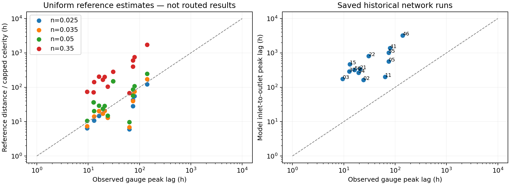

# Real-case timing reference audit — 30 September 2026

Reference: **REAL-TIMING-2026-09-30**. Written after reconsidering absolute peak-time change as a predictor target. The immediate question was whether the revised Manning n makes modelled timing sufficiently close to gauge timing to interpret predicted hours physically.

## Decision supported by this check

Use absolute timing change as a candidate target for predicting model outputs. Do not yet label it a validated real-world time saving. Revised reference celerities are substantially more plausible, but no revised real-network routing was run in this audit. Parent timing agreement is necessary evidence, not validation of an unobserved collapsed-state counterfactual.

## Scope and reproducibility

All 13 available independent anchored real-case preparations were inspected. Gauge distances use projections on the fixed single-thread reference; observed lags use first discharge maxima in the existing quality-sheet window. Recomputed saved hydrograph lags use outlet maximum minus input maximum. Reference scenarios hold stored BASED depth and reference slope fixed and test n=0.35, 0.025, 0.035 and 0.05. Each uses its existing case-specific celerity caps. No production files, slopes, hydraulic choices, or main notebooks were changed.

Run `OPENBLAS_NUM_THREADS=1 OMP_NUM_THREADS=1 MPLCONFIGDIR=/tmp/synthetic-mpl /opt/anaconda3/envs/river-hierarchy-rivgraph/bin/python RAPID/investigations/real_timing_reference_audit.py`.

## Results

All saved preparation manifests still specify n=0.35. Historical routed lag / observed lag ranges from 3.18 to 35.75, with median 17.39. These saved hydrographs are historical diagnostics: seven experiments have width-refresh markers, and run/preparation identity after refresh is not established. They are not results of the selected synthetic alpha=.65 configuration.

The following estimated times assume the entire gauge distance travels at the reference-section celerity. They are NOT new routed outlet predictions.

| Case | Gauge lag (h) | Historical routed lag (h) | Uniform reference estimate, n=.035 (h) | Reference estimate error (%) |
|---|---:|---:|---:|---:|
| 02 | 24.00 | 164.24 | 12.93 | -46.1 |
| 03 | 9.50 | 175.40 | 7.41 | -22.0 |
| 05 | 74.75 | 570.85 | 39.80 | -46.7 |
| 11 | 63.50 | 202.21 | 6.86 | -89.2 |
| 15 | 13.01 | 465.09 | 14.31 | +10.0 |
| 21 | 20.75 | 339.17 | 20.65 | -0.5 |
| 22 | 30.50 | 806.82 | 151.17 | +395.6 |
| 37 | 12.75 | 289.00 | 36.82 | +188.8 |
| 41 | 79.25 | 1377.92 | 75.37 | -4.9 |
| 46 | 140.33 | 3217.33 | 172.46 | +22.9 |
| 54 | 19.33 | 265.65 | 17.09 | -11.6 |
| 55 | 74.75 | 1015.97 | 60.27 | -19.4 |
| 56 | 16.17 | 318.90 | 20.49 | +26.7 |

At n=.035 the median absolute reference-time error is 22.9%; 7/13 estimates are within 25% and 10/13 within 50%. Median signed error is -4.9%. These are descriptive screening bands, not an established acceptance standard. They do not show that the real routed networks achieve these errors.

For n=.025 and .05 the corresponding median absolute errors are 32.0% and 38.2%; for historical n=.35 it is 763.2%. This is not an independent calibration/validation split or a recommendation to fit roughness to every peak.

## Exceptions that matter

- **22:** observed apparent speed 3.22 m/s, revised raw reference celerity 3.46 m/s, but stored maximum cap is 0.65 m/s. The capped reference time is 151.2 h versus observed 30.5 h. The cap would affect about 72.6% of mapped segment length with the existing alpha=1 depth relation, or 92.5% in the diagnostic alpha=.65 scenario. Even the selected synthetic maximum 2.524 m/s is below the apparent gauge speed. Do not silently remove or raise this cap; first reconcile its numerical rationale, geometry and gauge event.

- **37:** observed speed 1.88 m/s, raw reference celerity 3.33 m/s, again capped at .65 m/s. Reference time is 36.8 h versus 12.75 h. Diagnostic upper-cap length fractions are 43.0% (alpha=1) and 85.1% (alpha=.65). Removing the cap alone would still leave an overfast raw reference speed.

- **11:** revised reference time 6.86 h versus 63.5 h observed, without reference capping. Matching this with roughness alone would require n approximately .324 under the fixed reference assumptions. That is a reason to investigate the event, slope and reference assumptions, not to calibrate n blindly.

- **02 and 05:** reference estimates remain approximately 46% too fast.

## Observation and comparison limitations

- Equal observed maxima introduce timing ambiguity. Case 03 permits lags from 9.50 to 14.75 h depending on which equally high downstream maximum is chosen. Case 11 spans 58.75–81.75 h; case 41 spans 59.75–79.75 h. These are equal-maximum envelopes, not statistical confidence intervals. All cases and peak spans are exported in cases.csv.

- The quality sheet notes no clear upstream peak in 15, originally sparse sampling in 21, and differing event dynamics in 55. Current saved sampling intervals can reflect interpolation and do not prove native temporal resolution.

- Saved model forcing maxima differ slightly from gauge maxima after processing; offsets reach +5.13 h in 46, -1.80 h in 56 and +1.32 h in 05. Match windows and preprocessing before a final timing validation.

- Gauge-to-reference offsets are also exported; the largest is about 1.83 km in 41. Inlet/outlet model locations still need explicit equivalence to gauge locations before calling the comparison a calibrated reach travel time.

- A reference hydraulic celerity and a gauge apparent peak-propagation speed are different quantities. Real branching, routing storage, lateral inflow and event evolution can separate them. A uniform-reference improvement cannot establish network timing accuracy.

## Next validation needed

1. On the refreshed real slopes/widths, reroute only the parent baseline for all 13 cases with the agreed real-case hydraulic configuration. Keep the alpha choice explicit; it is not yet adopted from synthetics. Resolve the low caps rather than assuming the tenfold raw celerity increase passes through unchanged.

2. Compare peak times at matched gauge locations using the same event window. Report signed error, absolute relative error, and peak ambiguity/sampling. Keep poor-event cases visible and report a quality-screened subset without selecting on good model agreement.

3. Check stability of selected parent–child absolute timing differences across n=.025/.035/.05. Agreement of the parent alone does not guarantee robustness of the collapse effect.

4. If timing errors and effect sensitivity are acceptable for the intended claim, use absolute hours for prediction and the parent rising-limb normalization for interpretation. Until then describe hours as simulated, retain gauge-anchored relative effects with their transfer assumption explicit.

Files: cases.csv; reference_scenarios.csv; reference_summary.csv; provenance.json. The branch alpha sensitivity only examines celerity/capping on frozen geometry; it does not reroute or select a new real-case depth law.
